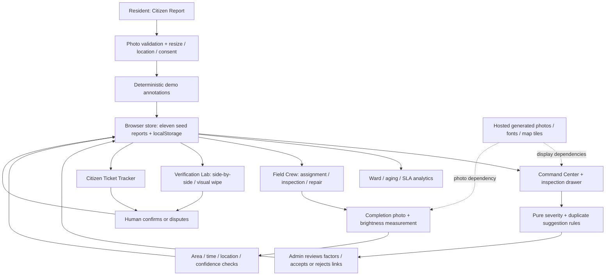

# CivicAI Sentinel — current architecture

## Current demo, not a proposed backend



Plain-text diagram for environments without Mermaid:

```text
Resident evidence -> validated photo -> demo annotations -> browser store
                                                           |       |
                                                admin triage    analytics
                                                    |
                                             crew work order
                                                    |
                                               after photo
                                                    |
                                    conservative comparison suggestion
                                                    |
                                       Lab / citizen human decision
                                                    |
                                          close / reopen -> store
```

| Boundary | Responsibility |
| --- | --- |
| `src/routes/*` | Screens and route-specific metadata; root shell/SSR bootstrap |
| `src/lib/sentinel/model.ts` | Categories, scores, bands, departments, crews, link/verification/SLA rules |
| `src/lib/sentinel/store.ts` | Seeds, subscriptions, persistence, shared completion/sign-off actions |
| `src/lib/sentinel/images.ts` | Asset pointers, fixed sample boxes, demo upload predictor, raster validation and canvas processing |
| `src/lib/sentinel/i18n.ts` | English/Tamil intake and core terminology |
| `src/components/sentinel/*` | Consistent evidence display, map, quick inspector, badges/factors |

Browser-only Leaflet is dynamically loaded behind a client boundary. Domain operations do not call a remote service. File validation is a UX safeguard, not a server security boundary. Changes persist only on this device. No production authorization, immutable audit service, uploaded-file storage service, or municipal API exists.

## Future production boundary (not implemented)

Authenticated resident/staff/crew views → authenticated server operations → per-user/department access policies → shared incident/evidence storage. A separately trained, versioned detector would return measured predictions through a verified inference service; human approval remains mandatory. Secure private images, retention/redaction, model validation, real spatial boundaries, observability and municipal agreements precede launch.
